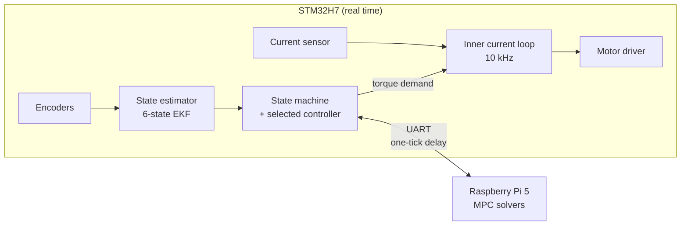
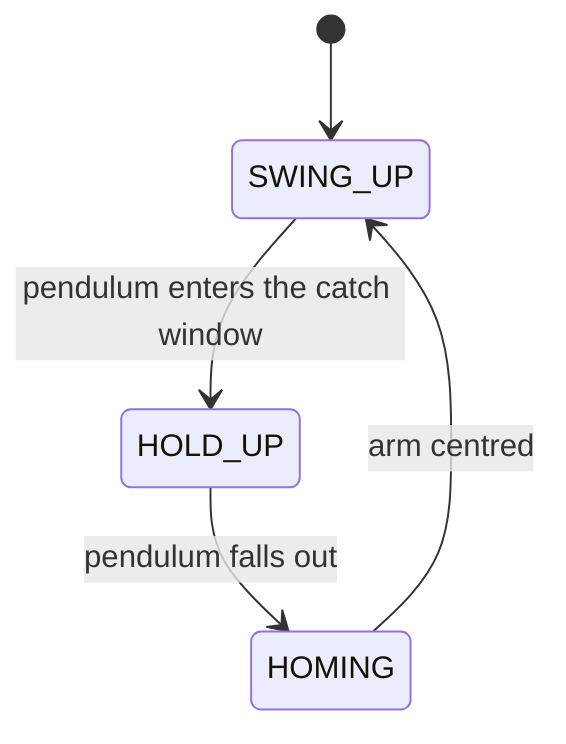

# Furuta Pendulum Control System: STM32 firmware

A real-time controller for a rotary inverted pendulum (Furuta pendulum), running
on an STM32H7 microcontroller with a Raspberry Pi 5 solving the heavy
optimisation problems.

A motor turns an arm in a horizontal plane. A free pendulum hangs off its tip.
The controller swings the pendulum up from hanging at rest, balances it upright,
and recovers when it is knocked down, all without winding the arm's cable past
its limit.

**What makes it interesting**

- Two nested real-time loops: a 10 kHz current loop and a 200 Hz pendulum loop
- A state machine that picks the right controller for each phase of the problem
- Nine interchangeable controllers behind one interface, from a linear gain to
  nonlinear MPC solved on another computer
- A deterministic link to the Pi that never makes the fast side wait for the slow side
- Controllers can be switched live from a serial console

> The Raspberry Pi half of the system is described in
> [`README_Furuta_Pi5_Core.md`](README_Furuta_Pi5_Core.md).
>
> **About this repository.** It shows the architecture and the code structure. It
> is a read-only showcase and is not meant to build or run. Identified plant
> parameters, tuned gains, the generated model expressions and the network
> weights are withheld or replaced with placeholders.

---

## The control problem

The task has two phases that need different control approaches:

1. **Swing-up.** The pendulum hangs down. Energy has to be pumped into it until
   it reaches the top, without driving the arm into its mechanical limit.
2. **Balance.** Near the top, a small-signal controller holds it upright against
   disturbances, friction and motor ripple.

Swing-up is strongly nonlinear. Balance is a small perturbation around one
point. Rather than one controller doing both, the system treats them as
separate jobs and hands over between them.

---

## System at a glance



The STM32 owns everything that must be deterministic: sensing, estimation,
timing and the motor. The Pi only does work that is too heavy for the
microcontroller, and the STM32 never waits for it.

### Two nested loops

| Loop | Rate | Job |
|---|---|---|
| Inner | 10 kHz (100 µs) | Turns a torque demand into a current reference, estimates the motor current with a small EKF, and closes it with a PI controller |
| Outer | 200 Hz (5 ms) | Reads the encoders, estimates the full state, runs the state machine, and computes the torque demand |

The loops talk through a small lock-free data layer (`Sensors`): the outer loop
publishes a torque demand, the inner loop publishes the measured current, and a
sequence counter guarantees the two encoder angles always come from the same
sample.

---

## State machine



| State | What runs |
|---|---|
| `SWING_UP` | Pumps energy into the pendulum until it is near upright |
| `HOLD_UP` | A balance controller holds it upright |
| `HOMING` | Drives the arm back to centre, so the next swing-up does not wind the cable |
| `STOP` | Manual pause, zero torque. Reachable from any state; the only state where controllers can be switched |
| `DEAD` | The arm passed its mechanical limit. Zero torque, and only a reset leaves it |

The state machine owns the transitions. A controller only answers "given this
state, what torque?" and never decides when another controller takes over.

---

## Controllers

Every controller exposes the same call, `torque = compute(state)`, so the state
machine does not know or care what is behind it.

| Controller | Used for | Idea |
|---|---|---|
| LQR | balance | Linear state feedback from a discrete-time design |
| Hierarchical SMC | balance | Sliding-mode control with a sliding surface per degree of freedom (Qian & Yi) |
| Unconstrained MPC | balance | Velocity-form MPC whose solution is precomputed offline, so one tick is one matrix-vector product |
| Neural network (hold-up) | balance | A small MLP trained to imitate a nonlinear MPC |
| Constrained MPC | balance | QP solved on the Raspberry Pi |
| Nonlinear MPC | balance | Solved on the Raspberry Pi |
| Energy swing-up | swing-up | Pumps the pendulum's energy to the upright level (Åström & Furuta) with arm centering |
| Neural network (swing-up) | swing-up | An MLP imitating a swing-up nonlinear MPC |
| Nonlinear MPC | swing-up | Solved on the Raspberry Pi |
| Homing | homing | PD that brings the arm back to centre |

All of them are built and kept ready at all times. Which one runs is a runtime
selection, changed from the serial console while stopped.

---

## State estimation

**Outer loop, 6-state EKF.** Estimates the angles, the angular rates, and a
disturbance torque on each of the arm and the pendulum, from the two encoder
angles and the applied torque. The disturbance states absorb friction and
everything the model leaves out. The model and Jacobians come from symbolic
equations of motion.

**Inner loop, 2-state EKF.** Estimates the motor current and a lumped voltage
disturbance (back-EMF and model error). Its measurement noise is adaptive: it
drops around reference edges so the filter follows real current steps, and in
steady state it tracks the measured ripple to keep the estimate smooth.

---

## Offloading to the Raspberry Pi

Constrained and nonlinear MPC solve an optimisation problem every tick. An early
attempt to run one on the STM32 took longer than the 5 ms budget, so the solve
moved to a Pi 5 running generated solver code.

The rule that makes this safe is that **the STM32 never blocks on the Pi**:

```
tick k:  collect the Pi's answer to the previous request
         send the current state to the Pi        (does not wait)
         apply the torque the Pi sent back
```

The torque applied now was solved from the state one tick earlier. That
one-tick delay is intentional: the 5 ms timing stays exact whatever the Pi is
doing, and the solvers predict one step ahead to compensate. If the Pi stalls or
is unplugged, the STM32 keeps ticking.

The link is a plain UART with fixed-size messages. Every reply starts with a
marker byte, because the Pi's Python timing is not exact and a reply can still
be arriving when the next tick starts listening. Without the marker, the bytes
of two replies could combine into a plausible but wrong torque. A frame without
the marker is dropped and counted as a missed reply.

Details: [`Remote_Controllers/README.md`](Furuta_STM32_Core/Control_Outer_Loop/Controllers/Remote_Controllers/README.md)

---

## Safety

Several independent layers, each covering a different failure:

- **Arm limit.** If the arm goes past the point where its cable would be damaged,
  the system goes `DEAD`: zero torque until a reset. It is checked every tick and
  overrides everything, including manual commands.
- **Message framing.** The marker byte on Pi replies, described above.
- **Solver faults.** If the Pi's solver fails to find a solution, the last good
  torque is held instead of applying a bad one.
- **Controller switching only while stopped.** A switch mid-run could hand a
  controller stale internal state.
- **Startup check.** Before an experiment, a ping/pong confirms the Pi is up.

---

## Debug console

A serial console runs the experiment live:

| Command | Effect |
|---|---|
| `start` | Begin the experiment |
| `stop` / `go` | Pause with zero torque / launch a swing-up (only from stop, so it can start from a disturbed state) |
| `hp_lqr`, `hp_smc`, `hp_umpc`, `hp_nn`, `hp_cmpc`, `hp_nmpc` | Switch the balance controller |
| `sw_eng`, `sw_nn`, `sw_nmpc` | Switch the swing-up controller |
| `trj<deg>` | Shift where the controllers think the arm centre is, live |
| `status` | Show the current state and selected controllers |

---

## Design principles

- **One interface, many controllers.** Swapping an algorithm never touches the
  state machine or the other controllers.
- **The state machine owns transitions.** Controllers do not decide when to hand over.
- **Never block the fast side on the slow side.** The one-tick delay trades a
  little control delay for exact timing.
- **Sample once, in one place.** The encoders have a single sampling point; everyone
  else only reads, through a seqlock when a consistent pair is needed.
- **Layered safety.** Each layer covers one understood failure, and they fail independently.
- **One source for each number.** Loop rates, plant parameters and design values
  each live in exactly one place.

---

## Repository map

```
Furuta_STM32_Core/            firmware for the STM32H7
  Control_Inner_Loop/           10 kHz current loop
    Control_loop/                 the loop itself
    Kalman/                       2-state current estimator
    Motor_Control/                PI current controller
  Control_Outer_Loop/           200 Hz pendulum loop
    Pendulum_Loop/                outer loop, state machine, controller bank
    Controllers/                  LQR, SMC, MPC, NN, energy swing-up, homing, remote (Pi)
    Kalman/                       6-state estimator
    dynamics/                     plant model, linear models, angle conventions
    TorqueConversion/             motor current <-> arm torque
  Libs/                         sensor, encoder, current-sensor and PWM interfaces
  Utilities/                    loop sample times, causal low-pass filter
  Shared/                       loop rates, log interface, logged-channel schema
Furuta_Pi5_Core/              solver application for the Raspberry Pi 5
  controllers/                  one class per solver
  solvers/                      constrained MPC, nonlinear MPC, swing-up NMPC
```

Hardware: STM32H755 (Cortex-M7), Raspberry Pi 5. The firmware is C++ with Eigen;
the offline design and code generation were done in MATLAB.
